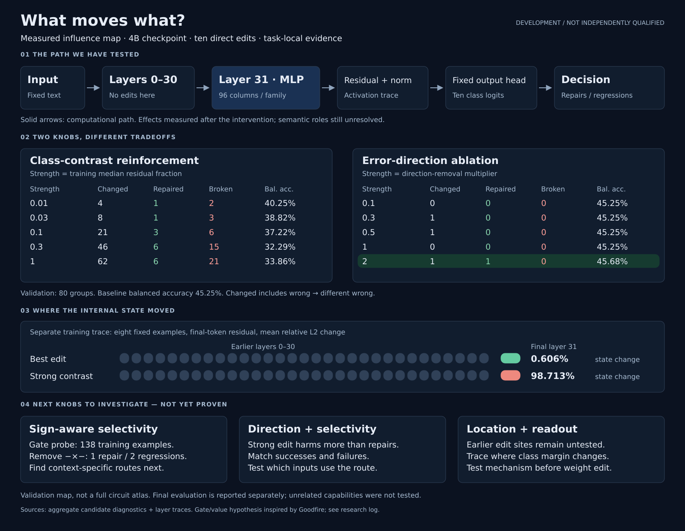

# Weight-space programming lab

Can bounded internal weight edits improve model behaviour? This lab records direct-edit experiments, unchanged baselines, diagnostics and clearly separated comparison methods.

**Development, coordinator-executed, not independently qualified (`isolation_unverified`).** Earlier classification labels are source metadata, not independently adjudicated truth; the new arithmetic trial uses computed answers. Public content is task-neutral; private conversations, actual requests, raw examples, individual predictions, credentials and operating details are excluded.

## Active weight-only replication

The active experiment tests an exact published loop-removal weight patch in a 0.8B model on fresh synthetic arithmetic, with unchanged prompts and decoding. Success requires at least ten percentage points held-out accuracy gain, paired p <= 0.05, and no guardrail accuracy loss. No gradients or replacement classifier. Patch hashes and exact restoration checks passed; measurement is in progress, with no outcome claimed yet. [Live progress, refreshed every 15 minutes](reports/loop-repair-03/status.json) · [Protocol, code and reproduction instructions](reports/loop-repair-03/README.md).

## Final results

A [longer-generation continuation](reports/loop-repair-04/README.md) is prepared, with fresh inputs and a predeclared two-trial significance correction. It has not started; GPU admission and remaining budget must pass first.

**Direct weight editing did not improve the final test.** The selected 4B edit repaired zero errors and broke one correct answer on 93 held-out groups across 14 dates. All choices were frozen before the final data opened; all ten arms ran once.

| Final arm | Accuracy | Balanced accuracy |
|---|---:|---:|
| 2B base | 18.28% | 24.82% |
| 2B frozen features + centroid | 47.31% | 36.08% |
| 2B frozen features + selected ridge | 53.76% | 50.73% |
| 4B base | 43.01% | 46.21% |
| 4B selected internal edit | 41.94% | 45.10% |
| 4B frozen features + centroid | 38.71% | 35.31% |
| 4B frozen features + selected ridge | 56.99% | 43.76% |
| 9B base | 55.91% | 53.12% |
| 9B frozen features + centroid | 51.61% | 53.77% |
| 9B frozen features + selected ridge | 70.97% | 62.67% |

The 9B comparisons met their registered development bars against corresponding 4B references. Gains come from model size and supervised readout, not successful direct weight editing. Comparisons are exploratory, without family-wise multiplicity correction. Small class supports and weak labels limit interpretation.

[Final report](reports/joint-final-02/REPORT.md) · [All aggregate results and intervals](reports/joint-final-02/aggregate-report.json) · [Closure audit](reports/joint-final-02/closure-check.json)

Trial 01 also completed without an improving edit: three searches selected identity. Its separate 182-group final set gave 37.36% accuracy / 42.26% balanced accuracy for the base and each selected arm. A prompt/decoding control scored 42.86% / 41.45%. [Original report](reports/cause-01/REPORT.md). Its generated-JSON decoder differs from Trial 02's fixed category-token choice; absolute scores are not directly comparable.

## What the diagnostics found

Ten initial direct edits were evaluated on 80 validation groups after training-only analysis on 138 groups. Strong contrast reinforcement changed many predictions but caused more regressions than repairs. The best validation edit corrected one extra case; this gain did not survive final evaluation. Six adaptive editor calls yielded one diagnostic-only response and five 300-second timeouts, with no evaluated adaptive patch. Timeout usage can be unknown.

A separate native gate/value probe used 138 training examples and 190 selected channels. Removing double-negative products repaired one error and broke two correct answers. Sign alone is not a harm label. This was an activation intervention, not a checkpoint edit.

[Research log](RESEARCH-LOG.md) records hypotheses, measurements, failures, uncertainty and next tests. The map covers tested final-layer interventions, not a full circuit atlas. A new efficacy experiment requires fresh evaluation data; completed final sets are not available for tuning.

## Research loop

1. Register input hashes, split, budgets, metrics and decision rules before measurement.
2. Diagnose with permitted training activations; state competing, falsifiable explanations.
3. Test bounded reversible interventions and validate sparse BF16 changes against immutable base tensors.
4. Select on fixed development data, retaining every proposal and failure.
5. Freeze all choices before final evaluation; score once and preserve original results.

The direct-edit arm forbids gradients, optimizers, iterative loss fitting, random weight search, output/embedding/norm edits and whole-matrix rescaling. Supervised references are labelled separately. Unrelated capabilities were not evaluated.

The [mechanistic researcher prompt](prompts/mechanistic-researcher-v1.md) is versioned and must be hash-pinned in a fresh registration before use. It requires native gate/value traces when available, causal controls, repairs versus regressions, exact evidence references and explicit unknowns. Historical runs retain their original prompt and budgets.

## Code and publication

Modules in `tools/weight_space_lab/` cover inference and exact BF16 restoration, restricted editor execution, activation diagnostics, model-size references, joint final evaluation and aggregate scoring. `tests/` contains authored synthetic checks. Private data and actual model calls are not distributed.

This public projection generalizes task wording, category labels and operating locations. Numeric results are unchanged; the projected prompts cannot reproduce historical private results without original authorized artifacts. See [publication boundary](PUBLICATION.md) and [file manifest](PUBLIC-MANIFEST.json).

Every published image uses dark mode, including SVG originals, PNG exports, README embeds and future diagrams.

Inspired by [Sparks of Weight-Space Programming](https://rikiyat.github.io/blog/weight-space-programming/) and [Goodfire's interpretability essay](https://already-clean.goodfire.com/). Their proposed mechanisms motivate tests; they do not establish a mechanism or improvement in this checkpoint.

## Mechanistic investigation

[Measured influence map](docs/influence-map.svg) traces tested edits to internal state changes and repairs/regressions. [Researcher prompt](prompts/mechanistic-researcher-v1.md) is versioned and hash-pinned for future registrations; existing calls retain their original prompt and budget. Gate/value instrumentation is a training-only diagnostic, not a weight edit.
