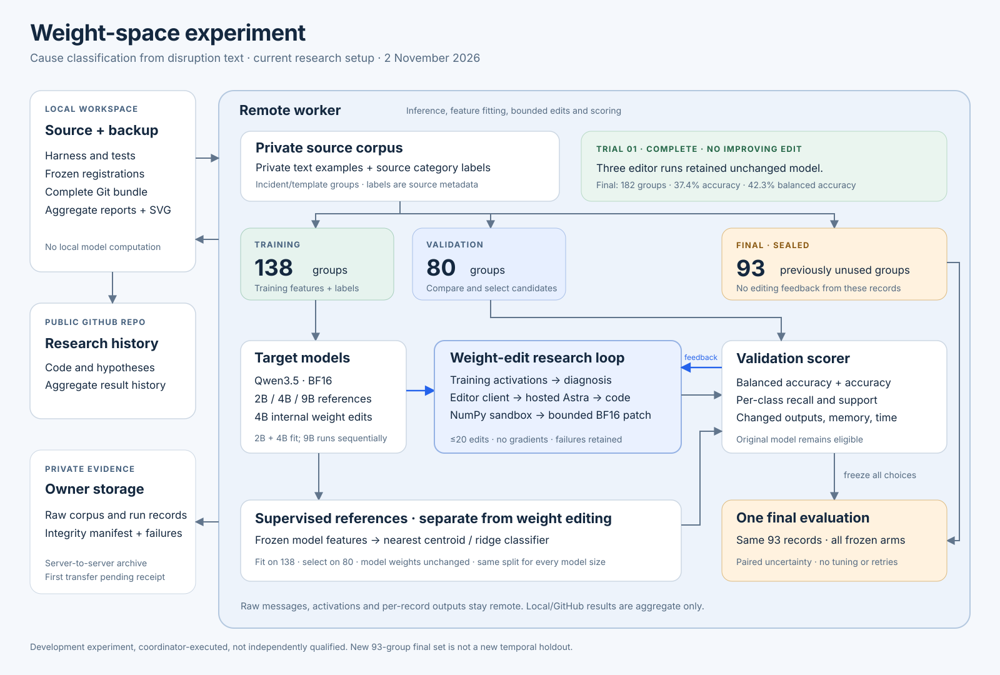

# Weight-space programming lab

Can direct neural-network weight edits improve text classification? This standalone lab compares bounded internal edits with unchanged models, prompt controls and supervised classifiers on frozen model features.

**Development, coordinator-executed, not independently qualified (`isolation_unverified`).** Source categories are weak labels, not independently adjudicated causal truth. Task and deployment details are withheld.

## Results

**Trial 01 completed; its registered bar was not met.** Three fresh editor sessions, five proposal slots each: twelve evaluated patches, one diagnostic-only proposal and two editor timeouts. All three searches selected the unchanged model. Final evaluation used 182 groups across eight later dates.

| Final arm | Accuracy | Balanced accuracy | Valid category JSON |
|---|---:|---:|---:|
| Unchanged 4B | 37.4% | 42.3% | 100.0% |
| Prompt/decoding control | 42.9% | 41.5% | 96.2% |
| Each of three selected edits | 37.4% | 42.3% | 100.0% |

[Final report](reports/cause-01/REPORT.md) · [Aggregate results](reports/cause-01/aggregate-report.json) · [Registration](registrations/cause-pilot-01.json)

**Trial 02 is still searching on development data.** The revised harness supplies training activations and logits. A fixed closed-choice decoder selects one of ten category tokens. These scores are not directly comparable with Trial 01's generated-JSON scores. Split: 138 training, 80 validation and 93 previously unused groups reserved for a joint final evaluation. The final set remains closed; it is a group holdout within the earlier period, not a new temporal holdout.

| Validation arm | Accuracy | Balanced accuracy |
|---|---:|---:|
| Unchanged 4B, closed-choice | 38.8% | 45.2% |
| Best initial internal 4B edit | 40.0% | 45.7% |
| 4B frozen features + nearest centroid | 57.5% | 54.3% |
| 4B frozen features + selected ridge | 66.3% | 61.2% |
| Unchanged 2B, same decoder | 17.5% | 21.8% |
| 2B frozen features + nearest centroid | 51.3% | 33.2% |
| 2B frozen features + selected ridge | 50.0% | 46.4% |

Ridge settings are selected by balanced accuracy, then accuracy. The best initial internal edit corrected one extra validation example. The larger gain comes from a **supervised classifier**, not weight editing. These are selection-set results, not established unseen-data gains. The six adaptive calls ended with one diagnostic-only response and five timeouts; no adaptive patch was evaluated. The 9B comparison completed: base 50.0% accuracy / 48.8% balanced accuracy; selected ridge 72.5% / 66.6%. Final evaluation remains sealed.

[Activation registration](registrations/cause-02.json) · [Model-size registration](registrations/model-size-01.json) · [Research log](RESEARCH-LOG.md)

## Research loop

1. Register input hashes, split, candidate limits, metrics and decision rules before measurement.
2. Diagnose with training activations; state a hypothesis before editing.
3. Run generated NumPy code in a restricted remote sandbox. Validate sparse BF16 replacements against immutable base tensors.
4. Evaluate on the fixed validation set. Keep every proposal, failure and receipt; identity is eligible.
5. Freeze all choices before opening the final set. Score once; never tune on final outcomes or retry scored final cases.

The internal-edit arm forbids gradients, optimizers, iterative loss fitting, random weight search, output/embedding/norm edits and whole-matrix rescaling. Supervised references are labelled separately. This task-specific pilot does not establish preservation of unrelated capabilities.

## Publication scope

Task-neutral reference code: task wording, labels and operating locations are generalized. Historical numbers are unchanged. This projection cannot reproduce private results without original artifacts; see [publication boundary](PUBLICATION.md).

## Execution and privacy

Target inference, feature fitting, scoring and sandbox execution run on Remote worker. The frontier editor is called through a remote Codex client with built-in tools disabled. Local files hold authored code, the diagram and aggregate metadata.

**Excluded from this repository and its history:** private message corpus, per-record predictions, agent conversations, inbox/outbox, private prompts, credentials, secrets and model caches. Full evidence archives remain under separate private custody. Reproduction requires the authorized corpus matching registered hashes; it is not distributed here. Timed-out editor calls can have unknown usage.

## Code map

- `inference.py`, `tensors.py`: pinned model inference, exact BF16 patching and restoration.
- `sandbox.py`, `model_client.py`, `edit_loop.py`: restricted editor execution and first trial.
- `prepare_second.py`, `activation_trial.py`, `adaptive_activation.py`: revised split and activation-guided search.
- `model_size_trial.py`: same-data model-size references.
- `trace_effects.py`: paired repairs/regressions, class margins and layer-level intervention traces.
- `classification.py`, `final_evaluation.py`: category metrics and first trial's final evaluation.
- `tests/`: authored synthetic checks, without private data fixtures.

Modules live in `tools/weight_space_lab/`. Commands target `/workspace/weight-space-lab` on the remote experiment machine. Trial output paths are single-use: inspect registrations and receipts before execution. Run applicable tests remotely with `.venv/bin/python -m pytest -q tests`.

Inspired by [Sparks of Weight-Space Programming](https://rikiyat.github.io/blog/weight-space-programming/). Its prominent language-model result repaired reasoning loops; that mechanism is not established for this classification task. This lab measures what transfers.
